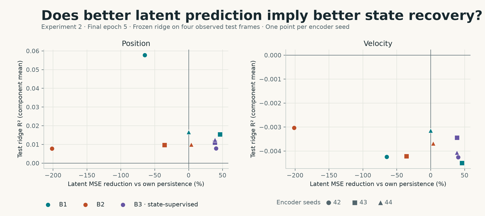
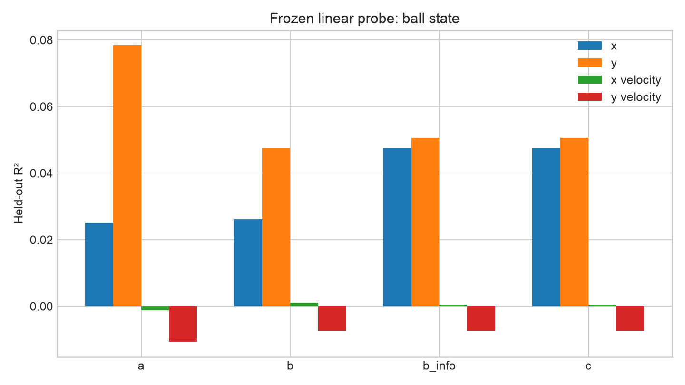
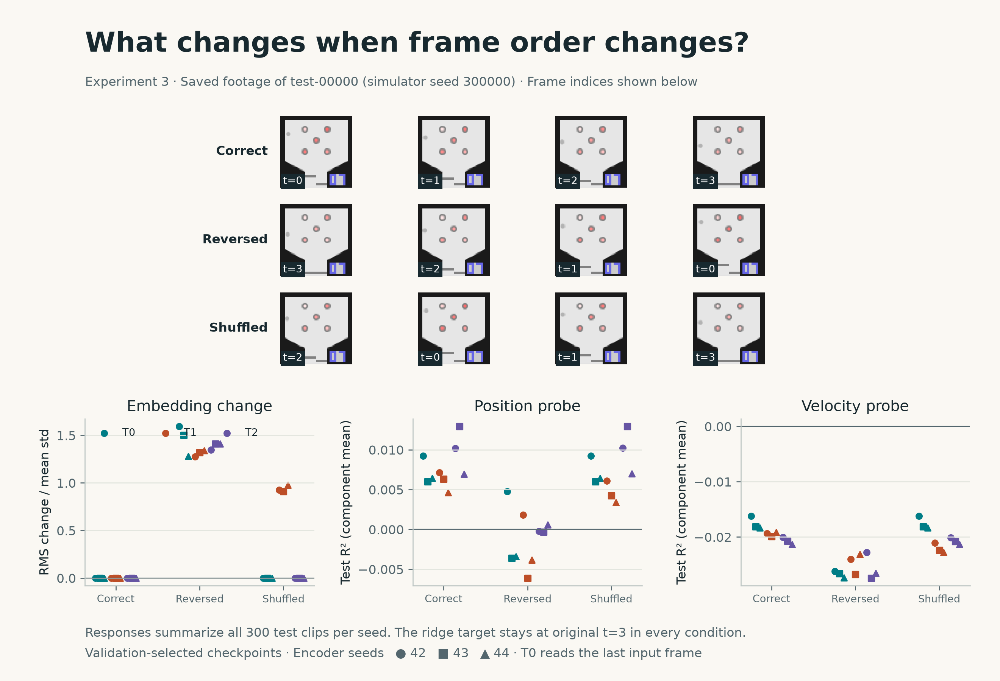
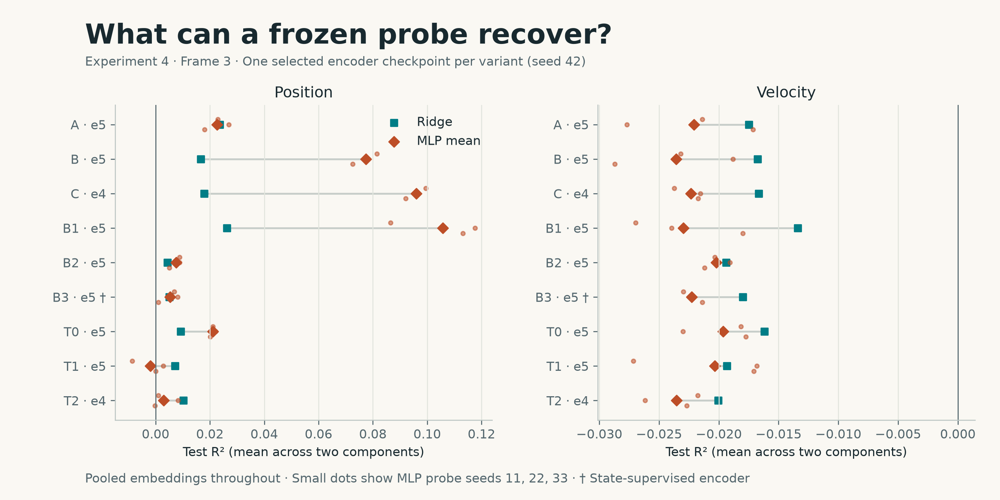

# The Predictive Representation Fallacy

**Why Low Latent Prediction Error Is Not Evidence of Physical Understanding**

Can a Joint-Embedding Predictive Architecture (JEPA) predict its own latent targets while learning features that reveal little about the underlying physical state? Four exploratory experiments on Causal Pinball examine that question by measuring latent prediction, embedding geometry, and the recovery of ball position and velocity from frozen features.

[Key findings](#key-findings) · [Experimental design](#experimental-design) · [Experiments](#experiments) · [Reproducibility](#reproducibility) · [Limitations](#limitations)



*Figure 1. Latent prediction and physical-state recovery in Experiment 2. Each point represents an epoch-5 encoder trained with seed 42, 43, or 44. The horizontal axis is the percentage reduction in latent MSE relative to that run’s own persistence baseline across 900 held-out transitions. The vertical axes show mean component-wise ridge-probe R² for ball position and velocity across the first four observed test frames. B3 uses state supervision during training.*

## Overview

A JEPA learns to predict the embedding of a target observation from a context observation. Here, an online encoder represents the context, a predictor maps it toward the target, and a stop-gradient target encoder follows the online encoder by exponential moving average. Predicting in representation space lets a model discard visual detail that is irrelevant to the prediction task. It also makes prediction error depend on what the encoder retains and on the scale of its features.

This project asks whether the learned features retain ball position and velocity and whether that information is accessible to downstream readouts. The latent persistence baseline asks how much the predictor improves on reusing the current target-encoder embedding. A frozen probe asks how well a readout trained on labeled examples can recover state from an observed input. These are distinct tests of the same encoder.

## Key findings

- **Beating persistence coexisted with weak state recovery.** In Experiment 1, object-centric Model B reduced latent MSE by 31.6% relative to its own persistence baseline. Its frozen ridge probe reached y-position R² of 0.047, with both velocity components near zero.
- **Higher effective rank did not reliably improve state recovery.** Experiment 2’s normalized regularization raised effective rank across all three seeds while sharply contracting raw embedding scale. In Experiment 3, both temporal encoders increased rank relative to the framewise control, while frozen state probes remained weak.
- **Readout capacity changed what could be recovered.** On a selected B1 checkpoint, y-position R² rose from 0.054 to 0.210 with a nonlinear readout on pooled slots, and from 0.251 to 0.390 on concatenated slots. Velocity remained difficult to recover. These are exploratory comparisons on previously examined encoders and test data.

## Experimental design

**Data.** The splits contain 2,400 training, 300 validation, and 300 test trajectories, with disjoint simulation seeds and sequence IDs. Each trajectory is initialized independently using the pinned upstream Causal Pinball simulator. The loader streams compressed simulator archives containing 16 RGB frames at 64 × 64, aligned states, and 15 rows of five binary intervention indicators. Video batches are float32 in [0, 1] with shape `[B, T, C, H, W]`. Rendering omits the upstream velocity projection. [Generation wrapper](scripts/prepare_pinball.py) · [Dataset loader](src/ijepa/data/pinball.py)

Intervention indicators identify which mechanisms were replaced for a transition. Multiple indicators can be active, and ordinary dynamics also change the state. Model C receives the recorded indicators for the transition it predicts. Simulator ball labels train the B3 reference and the supervised readouts and baselines.

| Family | Representation and predictor | Experiment |
| --- | --- | --- |
| A · Global Video JEPA | Frame CNN with global pooling and a latent MLP predictor | 1, 4 |
| B · Object-Centric JEPA | Eight learned attention queries over frame features, a relational Transformer, and a slot-wise predictor | 1, 4 |
| C · Intervention-Conditioned JEPA | Model B with an additive embedding of the five transition indicators. B+I duplicates C in the controlled run. | 1, 4 |
| B1–B3 · Regularization and supervision | Model B with the original controlled objective, normalized regularization, or the original objective plus a supervised state head | 2, 4 |
| T0–T2 · Temporal modelling | Last-frame baseline, per-slot temporal convolutions, and per-slot temporal Transformer, respectively | 3, 4 |

**Training and controls.** The controlled runs use 32-dimensional features, AdamW at 0.0003, target EMA momentum 0.99, and five epochs on Apple Silicon MPS. Experiments 1–2 use the first four frames, all three adjacent transitions, and batch size eight (1,500 steps per run). Experiment 3 uses the first five frames, one transition per sequence, and batch size 16 (750 steps per run). Experiments 1 and 3 select checkpoints on validation objective. Experiment 2 uses the fifth epoch for every run. The standalone YAML presets in `configs/` configure the original trainer and differ from these controlled runs.

**Measurements.** Prediction ratios use next-latent MSE divided by same-model target-space persistence MSE. A ratio below 1 favors the learned predictor. Raw latent MSE depends on each model’s embedding scale. Mean feature standard deviation measures scale. Effective rank is the exponential entropy of the normalized covariance spectrum and measures how broadly variance is distributed across dimensions. The frozen ridge and MLP probes score simulator ball position and velocity component-wise on held-out sequences. Negative R² indicates error above that of the evaluated split’s mean target.

## Experiments

### 1 · Predictive representation learning

**Hypothesis.** Object-centric features could improve physical-state recovery, and recorded intervention labels could help next-latent prediction.

**Method and result.** A, B, B+I, and C share the same seed (42), split, training budget, and adjacent-frame loss with variance and covariance penalties. B and C beat their own persistence baselines, while A trailed its baseline. B+I and C share the implementation, objective, and seed and produced identical results. The comparison therefore provides a conditional prediction measurement with observed intervention labels. Identifying an intervention effect would require a separate evaluation. [Experiment 1 report](outputs/research_summary.md#causal-pinball-controlled-jepa-experiment) · [Saved metrics](outputs/experiments/controlled/metrics.json)

[](outputs/figures/probe_results.png)

*Figure 2. Frozen ridge R² for ball position and velocity on the four observed test frames in Experiment 1. B+I and C are duplicate runs.*

### 2 · Representation collapse

**Hypothesis.** Stronger variance and covariance regularization could improve the usefulness of object-centric latents. A supervised reference tests whether direct state labels help under the same setup.

**Method and result.** B1 retains the original regularizers, B2 applies new variance and covariance settings to normalized pooled features while predicting in raw latent space, and B3 adds a supervised linear state head to B1. At seeds 42–44, B2's effective rank was 2.98–3.80 versus 2.07–2.99 for B1, while its raw mean feature standard deviation fell to 0.0032–0.0045 versus 0.0902–0.1022 for B1. B2 y-position R² ranged from 0.016 to 0.020. B3 also recovered little state. That weak supervised reference leaves architecture, optimization, and loss weighting as possible explanations alongside collapse. Figure 1 shows the complete nine-run comparison. [Methods](outputs/experiment2/methods.md) · [Experiment 2 report](outputs/research_summary.md#experiment-2-does-anti-collapse-help-physical-representations) · [Saved metrics](outputs/experiment2/metrics.json)

### 3 · Temporal modelling

**Hypothesis.** A short history could make motion information available to the encoder and improve frozen velocity recovery.

**Method and result.** The matched T0 baseline sees only the final image. T1 and T2 encode four-frame windows, with inputs at frames 0–3 and EMA targets at frames 1–4. Across seeds 42–44, effective rank rose from 1.01–2.07 for T0 to 4.38–5.01 across T1 and T2. Their prediction-to-persistence ratios ranged from 1.091 to 1.275, and every velocity R² was negative. T1 features responded to shuffling earlier frames while holding the endpoint fixed, yet the ridge probes showed little usable motion signal under this budget. [Experiment 3 report](assets/reports/temporal-modelling.md)



*Figure 3. Order sensitivity across 300 held-out clips per checkpoint and seeds 42–44. The frame-3 label and fitted readout are held fixed. Reversal also changes the final image. The filmstrip shows one example input, while the plots summarize test-set responses.*

### 4 · Nonlinear probing

**Hypothesis.** A small MLP could recover state that a linear readout misses.

**Method and result.** Nine preselected seed-42 encoders are frozen. Ridge and two-hidden-layer GELU MLPs read the same features at observed frame 3. T1 and T2 receive frames 0–3. Probe preprocessing is fitted on training data, and validation loss selects the MLP epoch. The pooled and concatenated B1 y-position gains show that accessible information depends on both readout capacity and slot aggregation. A matched four-frame pixel ridge reference reached position R² of 0.941 and 0.947 and velocity R² of 0.140 and 0.052. The three MLP seeds measure probe variability on fixed encoders. [Experiment 4 report](assets/reports/nonlinear-probing.md)



*Figure 4. Test R² averaged across the two components of position or velocity for pooled frozen features. Diamonds show means across MLP seeds 11, 22, and 33. The table below reports individual coordinates for B1.*

## Results

**Experiment 1 · Held-out test, seed 42, validation-selected checkpoints.** Gain is 100 × (1 − prediction/persistence). The effective rank is measured in a 32-dimensional feature space.

| Model | Epoch | Prediction / persistence | Gain | Effective rank | Position R² (x, y) | Velocity R² (x, y) |
| --- | ---: | ---: | ---: | ---: | --- | --- |
| A | 5 | 1.081 | −8.1% | 4.76 | 0.025, 0.078 | −0.001, −0.011 |
| B | 5 | 0.684 | +31.6% | 2.53 | 0.026, 0.047 | 0.001, −0.007 |
| C / B+I | 4 | 0.514 | +48.6% | 2.17 | 0.047, 0.051 | 0.001, −0.007 |

Experiment 2’s B1 seed-42 run used a fixed-final-epoch protocol and had a prediction-to-persistence ratio of 1.65. Experiment 2’s state probes cover four observed frames, while the primary probes in Experiments 3 and 4 score frame 3.

**Experiment 4 · B1, encoder seed 42, epoch 5.** MLP entries average three readout seeds. Each row reports a separate feature aggregation and fitted readout.

| Frozen features | Readout | Position R² (x, y) | Velocity R² (x, y) |
| --- | --- | --- | --- |
| Pooled slots | Ridge | −0.001, 0.054 | 0.000, −0.027 |
| Pooled slots | MLP | 0.002, 0.210 | −0.013, −0.033 |
| Concatenated slots | Ridge | 0.024, 0.251 | −0.009, −0.024 |
| Concatenated slots | MLP | −0.005, 0.390 | −0.022, −0.014 |

[View the observed-state animation](assets/figures/observed-ball-position.gif). The simulator provides the footage. The two markers on frame 3 show the simulator ball center and the same-frame estimate from the concatenated-slot MLP with probe seed 11. The three clips illustrate the 10th, 50th, and 90th percentiles of that readout’s position error.

## Reproducibility

Run from the repository root in a fresh checkout to keep existing outputs intact. The recorded environment uses Python 3.11 and PyTorch 2.15.0. The training entry points default to Apple MPS when available and otherwise use CPU. The original and controlled trainers also accept `--device cpu`. Local hardware was an Apple M2 with 8 GiB unified memory. The Experiment 3 report records about 19–20 seconds per five-epoch run on MPS, including validation and checkpoint I/O and excluding probes. CPU timings and cross-device metric equivalence were not measured here.

```sh
git submodule update --init --recursive
uv venv --python 3.11 .venv
uv pip install --python .venv/bin/python -r requirements-pinball.txt pytest
mkdir -p outputs/figures
.venv/bin/python scripts/prepare_pinball.py --workers 3
.venv/bin/python scripts/verify_replay.py
.venv/bin/python scripts/verify_pinball.py
.venv/bin/python -m pytest -q
```

The generator skips existing sequence archives. The verification script writes smoke checkpoints and a dataset preview. The split manifests are included, while the RGB archives are generated locally.

<details>
<summary>Original trainers and controlled Experiments 1–2</summary>

The original trainer uses a 64-dimensional latent, a 16-frame window, and adjacent-frame MSE without the variance and covariance terms used in the study.

```sh
for config in configs/*.yaml; do
  .venv/bin/python scripts/train.py --config "$config"
done
```

Use the historical run names in a fresh checkout to produce the checkpoints that the nonlinear probe script expects. The evaluation command computes persistence, collapse diagnostics, and frozen ridge probes, and produces the Experiment 1 plots under `outputs/figures/`.

```sh
for model in a b b_info c; do
  .venv/bin/python scripts/controlled_experiment.py --model "$model" --name "full_$model" --epochs 5 --patience 10
done
.venv/bin/python scripts/audit_experiment.py
.venv/bin/python scripts/evaluate_controlled.py --names full_a full_b full_b_info full_c --group controlled --split test

for variant in b1 b2 b3; do
  for seed in 42 43 44; do
    .venv/bin/python scripts/collapse_experiment.py train --variant "$variant" --seed "$seed"
  done
done
.venv/bin/python scripts/collapse_experiment.py baseline
.venv/bin/python scripts/collapse_experiment.py evaluate
.venv/bin/python scripts/audit_collapse_slots.py
.venv/bin/python scripts/plot_collapse_experiment.py
```

</details>

<details>
<summary>Experiments 3–4 and article figures</summary>

The Experiment 4 entry point expects the Experiment 1–3 checkpoints at their historical paths. Run the experiments in order to create those checkpoints and the cached predictions used by the article generator. The published metrics and plots can be inspected without rerunning training.

```sh
.venv/bin/python scripts/experiment3_supervised.py
.venv/bin/python scripts/experiment3_tiny.py
.venv/bin/python scripts/experiment3_temporal.py --epochs 5 --seeds 42 43 44
.venv/bin/python scripts/plot_experiment3.py
.venv/bin/python scripts/report_experiment3.py

.venv/bin/python scripts/experiment4.py
.venv/bin/python scripts/experiment4_pixel_four.py
.venv/bin/python scripts/experiment4_aggregate.py
.venv/bin/python scripts/plot_experiment4.py

.venv/bin/python outputs/substack/generate.py
```

The article generator reads saved metrics, cached probe predictions, simulator clips, and the corresponding checkpoints. It verifies checkpoint hashes and requires FFmpeg with libx264 for MP4 export. Set `FFMPEG_BINARY` to a working executable if the system FFmpeg is unavailable. The animation export was verified with the binary provided by `imageio-ffmpeg`. Selected rendered assets are included with this README.

</details>

## Repository structure

```text
assets/                  Publication figures and copies of the later reports
configs/                 Original A, B, and C training presets
data/manifests/          Train, validation, and test sequence indices
external/CITRIS          Pinned upstream simulator and renderer
src/ijepa/data/          Causal Pinball loader
src/ijepa/models/        Frame encoders, latent predictor, and EMA targets
scripts/                Generation, training, evaluation, and plot entry points
tests/                  Label, readout, and model checks
outputs/                Research summary and selected results
  experiments/          Experiment 1 run configurations, histories, and metrics
  experiment2/          Collapse metrics, baselines, and slot audit
  experiment3/          Temporal metrics, diagnostics, and figures
  experiment4/          Nonlinear metrics and figures, plus locally generated caches
  substack/             Article generator and rendered exports
```

Checkpoints, generated datasets, and most run directories are excluded by Git ignore rules. Saved metrics and selected plots for all four experiments are included under `outputs/`.

## Limitations

- **Scale and selection.** These are small CNN-based models trained for five epochs on 2,400 trajectories in one simulator. Experiment 1 uses a single encoder seed, Experiments 2–3 use three each, and Experiment 4 revisits one selected encoder seed per family after earlier test-set inspection.
- **Prediction horizon.** The study evaluates adjacent frames or overlapping contexts shifted by one frame. It provides no measurement of long-horizon autoregressive stability or recovery after compounding prediction errors.
- **Objects and interventions.** The slots are indexed by learned queries. Persistent physical object identity was unverified. Intervention groups are observational slices of test transitions, with no validated matched counterfactual branches or distinct causal-effect objective.
- **Readouts and generalization.** Probe scores depend on the features exposed, observation window, supervision, and readout class. Weak probe performance leaves open whether a different readout could recover more. A successful probe shows recoverability under its protocol. Generalization to large pretrained JEPAs remains untested.

## Research implications

What would constitute evidence that a predictive world model has learned physically useful dynamics? Persistence tests measure gains within a target space, effective rank measures how variance is distributed, and frozen probes measure recoverability under a specified readout. The open question is which combination of these diagnostics, multi-step state forecasts, and controlled intervention tests can establish that a representation supports reliable physical predictions beyond the training setting.

## References and attribution

- Yann LeCun (2022). *A Path Towards Autonomous Machine Intelligence*. [Position paper](https://openreview.net/pdf?id=BZ5a1r-kVsf)
- Adrien Bardes et al. (2024). *Revisiting Feature Prediction for Learning Visual Representations from Video*. [V-JEPA paper](https://arxiv.org/abs/2404.08471)
- Phillip Lippe et al. (2022). *CITRIS: Causal Identifiability from Temporal Intervened Sequences*. [ICML proceedings](https://proceedings.mlr.press/v162/lippe22a.html)
- Phillip Lippe et al. (2023). *Causal Representation Learning for Instantaneous and Temporal Effects in Interactive Systems*. [iCITRIS paper](https://openreview.net/forum?id=itZ6ggvMnzS)

The Causal Pinball experiments use the CITRIS/iCITRIS simulator and Matplotlib renderer from Lippe and colleagues, pinned at revision `95f6c90b9ff769ef0250d3a5434b9352853f4302`. This repository’s generated trajectories use its own split and seeding wrapper. [Official project and Causal Pinball data](https://github.com/phlippe/CITRIS#datasets) · [Upstream software license](https://github.com/phlippe/CITRIS/blob/95f6c90b9ff769ef0250d3a5434b9352853f4302/LICENSE)